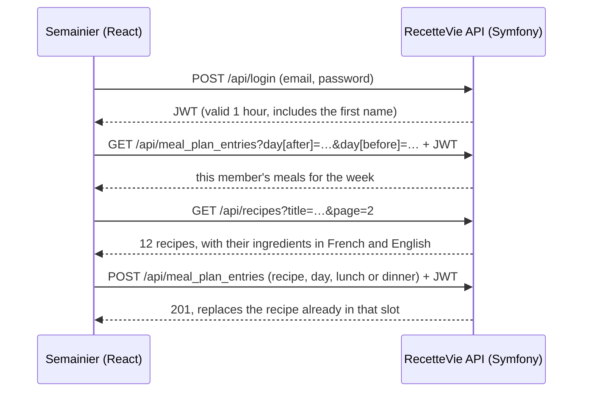

# Semainier

**A React app to plan the week's meals and get the shopping list, built on the RecetteVie API.**
*Application React pour planifier les repas de la semaine et obtenir la liste de courses.*

### 👉 [Try the live demo](https://puremax-lab.alwaysdata.net/semainier)

You can also open it from RecetteVie, with **Planifier mes repas** (**Plan my meals** in English) in the menu.

The app opens in the language of your browser, English if it is neither French nor English: switch with **FR** / **EN** at the top right. Click **fill in the demo account**, then **Log in** (it is the RecetteVie demo account: `camille@recettevie.test` / `password`).


-38A9B4)
[](https://github.com/puremax-lab/Semainier/actions/workflows/tests.yml)


## Two apps, one API

Semainier has no server of its own. It is a front end for [RecetteVie](https://github.com/puremax-lab/RecetteVie), my Symfony recipe website, to which I added a REST API with API Platform. The recipes, the accounts and the meal plans all live in RecetteVie, and RecetteVie links to Semainier from its menu, its home page and its footer, and Semainier links back from its header ("All recipes on RecetteVie") and its login screen, where a visitor without an account is sent to the RecetteVie sign-up page: for a visitor, the two apps feel like one site.



## What it does

- **Log in** with a RecetteVie account. The session survives a reload until the token expires.
- **Plan the week**: a lunch and a dinner for each of the 7 days. Pick a recipe in a side panel with search and infinite scroll, change it or remove it.
- **Move between weeks**: previous, current, next.
- **Shopping list**: the ingredients of the week's recipes, each line once, with the recipes it is for. Lines can be ticked off, and are remembered per week in the browser.
- **French and English**: a FR / EN switch on the login screen and in the header changes the whole app at once, with no reload. A first visit follows the language of the browser, with English for any language other than French or English, and the visitor's choice is then remembered in the browser. Recipe titles, ingredients, categories, dates and durations follow the language, and the search looks in the titles of the chosen language.
- **Responsive**: 7 columns on a desktop, the days one under the other on a phone.
- **Link preview**: Open Graph tags and a preview image, so a shared link shows a card on LinkedIn or in a chat.

## How it is built

- **React 19 with hooks only**: `useState`, `useEffect`, `useMemo`, `useCallback`, `useRef`. No router or state library: the app is one screen.
- **API calls in one place** ([`api.js`](src/lib/api.js)). A 401 answer turns into an `AuthError`, which logs the member out with a message.
- **No stale answers**: each `useEffect` that fetches data ignores the answer if the week or the search changed in the meantime ([`Planner.jsx`](src/components/Planner.jsx), [`RecipePicker.jsx`](src/components/RecipePicker.jsx)). The loading state is derived from what was asked and what was received, not set by hand.
- **Optimistic removal**: a removed recipe disappears at once, and comes back if the API refuses.
- **Infinite scroll** with an `IntersectionObserver`, plus a **Load more** button for keyboards and old browsers.
- **Side panel** with the native `<dialog>` element: focus kept inside, closed with Escape.
- **Shopping list logic** as a pure function ([`shopping.js`](src/lib/shopping.js)): lines are compared without case, accents or extra spaces ("3 œufs" and "3 oeufs" stay apart, "Sel, poivre" and "sel, poivre" merge).
- **Translations without a library** ([`messages.js`](src/i18n/messages.js), [`language.js`](src/i18n/language.js)): one dictionary per language and a React context. The API returns both languages of a recipe, so switching needs no new request. If a recipe has no English text, the French one is shown ([`recipe.js`](src/lib/recipe.js)). Errors travel as translation keys, so a message on screen changes with the language too.
- **One domain online**: both apps are served from `puremax-lab.alwaysdata.net`, so the browser needs no CORS. In development, Vite forwards `/api` to RecetteVie ([`vite.config.js`](vite.config.js)).
- **Tests** with Vitest and Testing Library (34 tests): dates, shopping list, session, login screen, the links back to RecetteVie, the planner with a mocked API (plan, remove, logout on 401) and the language switch (browser language on a first visit, live change, remembered choice, English search, same keys in both languages). They run on every push with GitHub Actions, with the linter (oxlint) and the build.

On the RecetteVie side, the API work is described in [its README](https://github.com/puremax-lab/RecetteVie#technical-highlights): read-only recipes, a `MealPlanEntry` resource limited to its owner, JWT login.

## Screens

The screenshots show the English version.

| Choosing a recipe | Shopping list |
|---|---|
|  |  |

| Login | Phone |
|---|---|
|  |  |

## Run it locally

Semainier needs RecetteVie running on http://127.0.0.1:8000 with its API set up (see [Run it locally](https://github.com/puremax-lab/RecetteVie#run-it-locally) in RecetteVie, including the JWT key pair). Then, with Node.js 22 or later:

```bash
git clone https://github.com/puremax-lab/Semainier.git
cd Semainier
npm install
npm run dev    # http://localhost:5173
npm test
```

## Good to know

A link preview (Open Graph tags) stays in French: the app is one static page, and the sites that read those tags do not run JavaScript. In the browser, the tab title and the description change with the language. The legal notice and the sign-up page are on RecetteVie, which has its own language switch, and ticked lines of the shopping list are remembered per language, because they are stored by their text.

## Credits

The recipe photos come from RecetteVie, which credits their [Unsplash](https://unsplash.com) photographers in [its README](https://github.com/puremax-lab/RecetteVie#photo-credits).

## Author

**puremax-lab**: [github.com/puremax-lab](https://github.com/puremax-lab)
